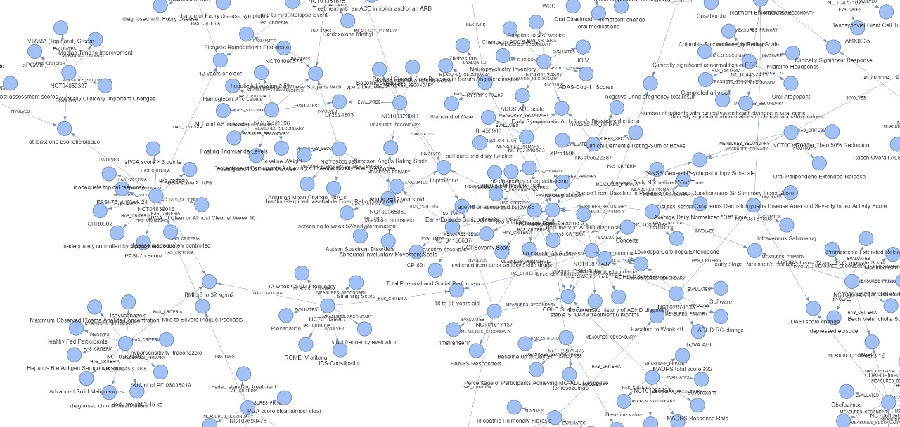
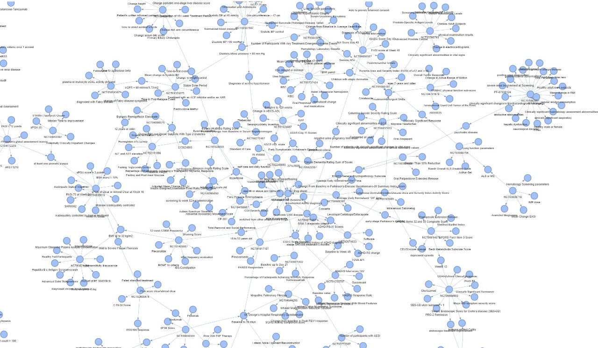
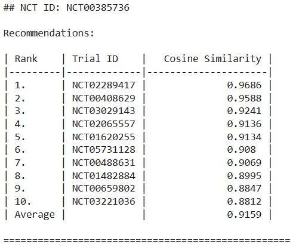
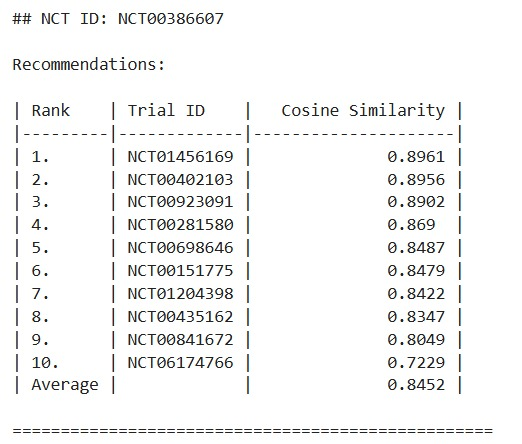
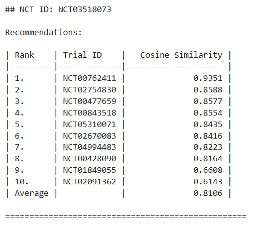

  <h1>AI-Powered Clinical Trial Recommender Using Knowledge Graphs</h1>
  <h3>Minor Project | B.Tech (ECE with Artificial Intelligence)</h3>
  

    <strong>Indira Gandhi Delhi Technical University for Women (IGDTUW), New Delhi</strong> 
    Academic Session 2026–2027 | Batch 2023–2027
  

## Project Team

- **Pragati Chaudhary** — 09401182023
- **Rishika Chaudhary** — 10401182023
- **Riya Mondal** — 10701182023
- **Tripti Bansal** — 14501182023

**Project Guide:** Prof. Maria Jamal  
**Department:** Electronics and Communication Engineering with Artificial Intelligence  
**Institution:** Indira Gandhi Delhi Technical University for Women (IGDTUW), New Delhi

> **Project provenance:** This academic project is based on the publicly available [`AI-KnowledgeGraph-ClinicalTrialRecommender`](https://github.com/ranjeetkulkarni/AI-KnowledgeGraph-ClinicalTrialRecommender) repository, used with permission from its original project owners. The upstream repository originates from a NEST 2025 hackathon project. The original project and its contributors are credited as the source of the code base. This README does not claim that the underlying code was independently authored from scratch by the IGDTUW team. Our report documents the system, studies its implementation, analyses its recorded outputs, and discusses its limitations.

## Project Overview

Clinical-trial records contain useful information about study objectives, interventions, outcome measures, and participant eligibility. Much of this information is written as free text, which can make it difficult to identify earlier trials that are conceptually similar to a given study.

This project documents and analyses a knowledge-graph-based workflow for retrieving similar clinical trials from **ClinicalTrials.gov** records. The documented pipeline combines language-model-assisted relationship extraction, semantic entity matching, graph construction, and graph-based similarity ranking.

The workflow represented in the project includes:

- Preparing trial text by combining the study title, primary and secondary outcome measures, and eligibility criteria.
- Extracting trial attributes into five relationship categories (`involves`, `evaluates`, `measures_primary`, `measures_secondary`, and `has_criteria`) using a language model.
- Identifying and consolidating near-duplicate entity names using Stella embeddings and FAISS, with a documented cosine-similarity threshold of 0.8.
- Storing the resulting subject–relationship–object records in a Neo4j knowledge graph.
- Retrieving the ten most similar trials for a query NCT identifier using Neo4j Graph Data Science node similarity with the Jaccard coefficient.
- Re-scoring the retrieved candidates with embedding-based cosine similarity as a separate, offline analysis step.
- Exploring a sample of the graph through a browser-based visualisation.

The recommendation stage and the graph visualisation are separate components. The visualisation displays a sample of the graph; it does not generate recommendations.

  
    
  

## Key Results

The report analyses recorded outputs for three illustrative query trials. The results below describe those recorded outputs and should not be interpreted as a comprehensive clinical evaluation.

- **Recorded Neo4j graph:** 17,441 total nodes and 39,380 stored relationships. The node count includes both trial nodes and entity nodes; it is not the number of clinical trials.
- **Recommendation output:** Ten Jaccard-based candidate trials were recorded for each of three example query trials.
- **Jaccard similarity:** Recorded scores ranged from **0.1818 to 0.6250** across the three example queries.
- **Cosine similarity:** The thirty query–candidate comparisons ranged from **0.6143 to 0.9686**, with a mean of approximately **0.857**.
- **Graph-viewer sample:** 471 nodes (68 trial nodes and 403 entity nodes) and 500 edges.

  <table>
    <tr>
      <td align="center"></td>
      <td align="center"></td>
      <td align="center"></td>
    </tr>
    <tr>
      <td align="center"><strong>Example Query 1</strong></td>
      <td align="center"><strong>Example Query 2</strong></td>
      <td align="center"><strong>Example Query 3</strong></td>
    </tr>
  </table>

**Important interpretation:** The mean cosine similarity of approximately **0.857 is not model accuracy, recommendation precision, recall, or proof of clinical relevance**. The cosine calculation re-scores the same candidates first retrieved through Jaccard similarity, using related extracted entity content. The report therefore treats this value as a descriptive semantic-similarity result only.

## Repository Contents

The project materials described in the report include the following components. File and folder names below should match the actual paths present in this repository.

- **`Python Scripts/CreateRelationship.py`** — Prepares merged trial text and performs language-model-assisted relationship extraction.
- **`Python Scripts/SimilarEntities.py`** — Uses Stella embeddings and FAISS to identify and consolidate similar entity names.
- **`Python Scripts/ingest.py`** — Loads the processed subject–relationship–object data into Neo4j.
- **`Python Scripts/model.py`** — Creates the graph projection and runs GDS node similarity to retrieve top-ten trial recommendations.
- **`metric_evaluation.py`** — Performs offline cosine-similarity analysis and re-ranking of the Jaccard candidate lists.
- **`results.txt`** — Contains the recorded Jaccard recommendation outputs for the example queries.
- **`nodes.json`, `edges.json`, and `index.html`** — Provide the sample graph data and browser-based visualisation.
- **`Python Notebooks/`** — Contains notebooks for recorded pipeline exploration, entity-merging work, and recommendation outputs.
- **`requirements.txt`** — Lists declared Python dependencies; check the notes below for dependencies that may need to be installed separately.

## Technology Stack

| Area | Technologies documented in the project |
|---|---|
| Data preparation | Python, pandas, NumPy |
| Relationship extraction | Groq API with Gemma 2 (`gemma2-9b-it`, historical configuration) |
| Semantic entity matching | Stella embeddings, SentenceTransformers, FAISS |
| Knowledge graph | Neo4j, Cypher, Neo4j Graph Data Science |
| Similarity analysis | Jaccard coefficient, cosine similarity, scikit-learn |
| Graph visualisation | vis-network, HTML, JSON |

## Quick Setup and Execution Notes

### Prerequisites

A complete execution environment may require:

- Python and the packages used by the project scripts.
- A Neo4j database with the required Graph Data Science functionality.
- The ClinicalTrials.gov CSV input expected by the preprocessing script.
- Securely configured service and database credentials where required by the scripts.

The raw registry CSV, intermediate processing files, and Neo4j database dump are not included in the project materials examined for the report. They must be supplied or generated separately before the complete pipeline can be reproduced. The report also notes that the inspected `requirements.txt` does not list every package used by the scripts (including `sentence-transformers`, `scikit-learn`, and `tabulate`), so verify the dependencies against the code before running the pipeline.

### Important model-availability note

The repository records **`gemma2-9b-it`** as the model identifier used for relationship extraction through Groq. According to the report's source review, this model identifier was shut down by Groq on **8 October 2025**. Therefore, the extraction stage should not be assumed to run unchanged today. Re-running it requires selecting and configuring a currently supported model. Any such change should be documented, and the extraction, graph, recommendations, and evaluation outputs should be regenerated; the historical results in the report should not be presented as results from the replacement model.

### Documented script sequence

The repository's documented workflow runs the following stages in order, after the required data, dependencies, and service configuration are available:

1. `Python Scripts/CreateRelationship.py`
2. `Python Scripts/SimilarEntities.py`
3. `Python Scripts/ingest.py`
4. `Python Scripts/model.py`
5. `metric_evaluation.py` (separate offline analysis of recorded/retrieved candidates)

The notebooks can be used to inspect the recorded experiments and supporting analysis. Their functionality should not be assumed to be identical to the Python scripts unless verified against the current repository.

## How to Explore the Project

### 1. Python scripts

Review the scripts in the documented sequence to understand the stages from trial-text preparation through graph construction and recommendation. Configure credentials outside the source code and do not commit API keys, passwords, or database connection details.

### 2. Jupyter notebooks

Open the notebooks in `Python Notebooks/` using Jupyter Notebook, JupyterLab, or a compatible IDE. They provide supporting exploration and recorded outputs for parts of the pipeline, including entity consolidation and recommendation analysis.

### 3. Knowledge graph visualisation

Open `index.html` in a compatible browser with its associated `nodes.json` and `edges.json` files available. The viewer displays a sample of the graph for exploration. It is a visualisation component only and does not run the Jaccard recommendation algorithm or the cosine evaluation.

## Evaluation Scope and Limitations

The results in the report are based on three illustrative query trials and recorded outputs. The project does not include manually annotated relevance labels or expert judgements for the recommended trials. As a result, the report does not claim precision, recall, MAP, NDCG, MRR, or clinical effectiveness.

Other limitations discussed in the report include:

- The quality of the language-model extraction has not been measured against a manually annotated reference set.
- The cosine evaluation uses entity content related to the graph connections used to retrieve the candidates, so it is not an independent relevance evaluation.
- The graph projection used for Jaccard similarity does not distinguish the five relationship categories during similarity calculation.
- The entity-merging threshold can miss synonyms or merge terms that should remain separate.
- Jaccard scores contain ties, which can make the order within tied groups arbitrary.
- The graph and browser viewer represent a subset/sample; the viewer contains 471 nodes and 500 edges.
- Reproduction is limited by the absence of the raw input, intermediate files, and database dump, and by the retired historical extraction-model identifier.

## Responsible Use

This system is intended as a **research-discovery aid** to help explore earlier trials that may resemble a query study. It must not be used to determine an individual patient's eligibility, recommend treatment, or replace the judgement of clinicians, investigators, or ethics committees.

## Credits and References

The implementation base and associated project materials are credited to the original owners of the upstream repository linked in the Project Provenance section above. It originated as a NEST 2025 hackathon project and was used with permission for this academic submission.

The IGDTUW minor-project report documents the repository's architecture and recorded behaviour, analyses the available Jaccard and cosine results, checks the interpretation of those results, and records implementation limits and future research directions. Technologies, datasets, papers, and other resources used in the work should be acknowledged in the report's reference list and in accordance with their respective licences and terms.

## Additional Resources

- **Evaluation script:** `metric_evaluation.py`.
- **Graph viewer files:** `index.html`, `nodes.json`, and `edges.json`.

---

*Prepared for the B.Tech Minor Project at IGDTUW, Academic Session 2026–2027.*
